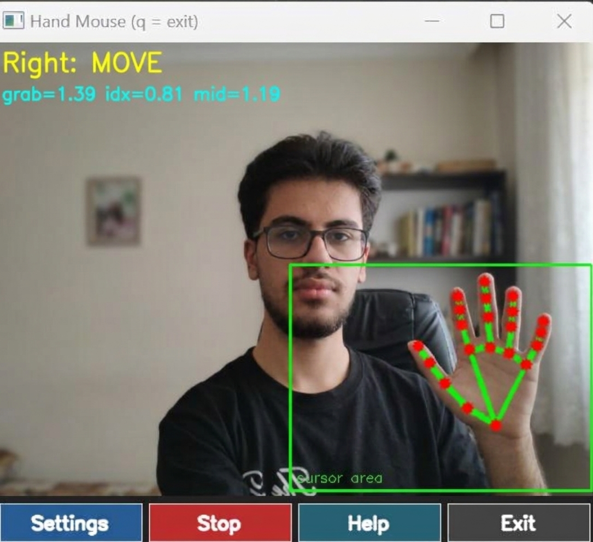
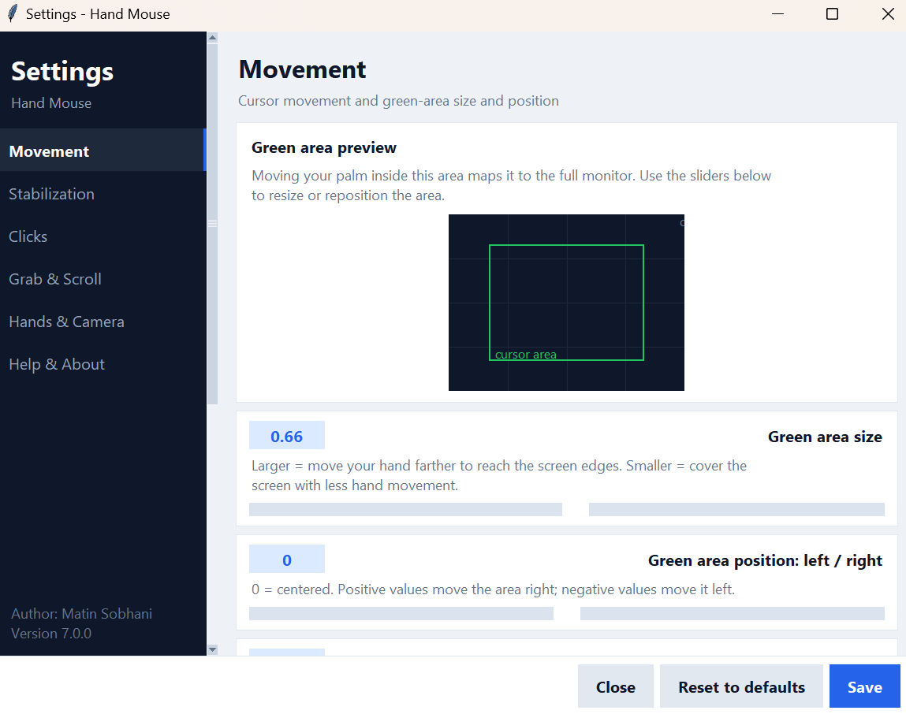
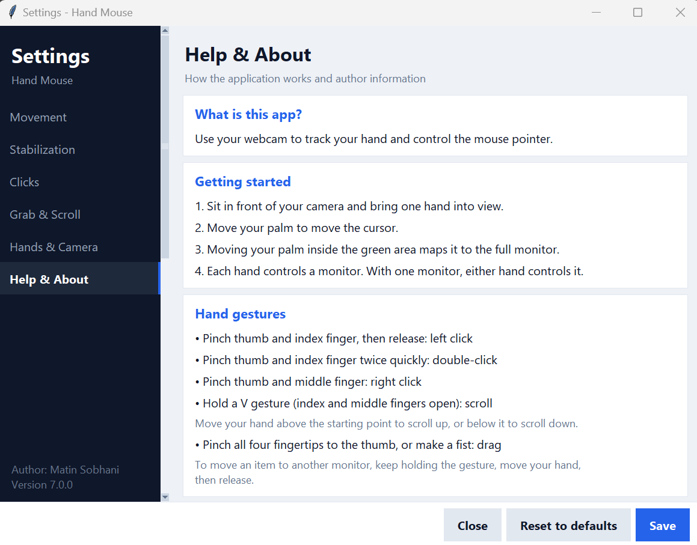
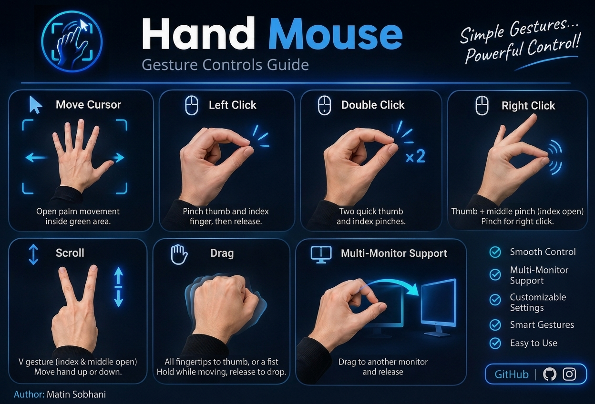

# 🖐️ Hand Mouse

### Control your computer with hand gestures.

A Python-based virtual mouse that uses your webcam and computer vision to track hand movements and control the mouse pointer — no physical mouse required.



<p align="center">
  **Version 7.0.0** · **Windows** · **Python** · **MediaPipe**
</p>

---

## ✨ Features

- Real-time hand tracking using MediaPipe Tasks
- Webcam-based cursor control
- Left click and double-click gestures
- Right click using hand gestures
- Gesture-based scrolling
- Drag and drop functionality
- Multi-monitor support
- Adjustable cursor sensitivity and smoothing
- Hand-tremor stabilization
- Customizable settings saved between launches
- Camera and runtime error handling

## 🖥️ Screenshots

### Main Window


### Movement Settings



### Help & About



## 🤚 Hand Gesture Controls

The following gestures are used to control the mouse:

| Hand Gesture | Action |
|---|---|
| Move an open palm | Move the cursor |
| Pinch thumb and index finger, then release | Left click |
| Pinch thumb and index finger twice quickly | Double-click |
| Pinch thumb and middle finger | Right click |
| Hold a V gesture (index and middle fingers open) | Scroll |
| Pinch all four fingertips to the thumb, or make a fist | Drag |



## 📥 Download

Download the latest Windows executable from the **Releases** section.

On the first launch, the application downloads the MediaPipe hand-landmarker model (approximately 7 MB). An internet connection is required unless the model is bundled with the executable.

## ⚙️ Run from Source

Use 64-bit Python on Windows.

```bash
python -m venv .venv
.venv\Scripts\activate
python -m pip install --upgrade pip
pip install -r requirements.txt
python hand_mouse.py
```

## 📦 Build the Windows Executable

Install the dependencies first. If you want to bundle the hand-landmarker model, download `hand_landmarker.task` and place it in the project directory.

Then run:

```bash
python -m PyInstaller --noconfirm --clean --onefile --windowed --name HandMouse --icon=hand_mouse_icon.ico --collect-all mediapipe --add-data "hand_landmarker.task:." hand_mouse.py
```

The executable will be created in the `dist` directory.

If you do not want to bundle the model, omit the `--add-data` argument. The application will download the model on first launch.

## 🔒 Privacy

Camera frames are processed locally by the application using MediaPipe.

The source code does not intentionally upload camera frames or hand-tracking data to a server. The hand-landmarker model is downloaded from Google's MediaPipe model hosting endpoint on first launch.

## 🛠️ Troubleshooting

- **Camera not detected:** Close other applications that may be using the webcam and check Windows camera privacy permissions.
- **Model download fails:** Check your internet connection, or provide a valid `hand_landmarker.task` file.
- **Mouse movement is unstable:** Adjust sensitivity, smoothing, and stabilization settings.
- **Dragging does not work in an application:** Try enabling **Real mouse input** in the settings.

## 📌 Project Status

Hand Mouse is a personal software project shared for experimentation, learning, and feedback.

Test the executable on your own Windows setup before relying on it for important work.

## 👨‍💻 Author

**Matin Sobhani**

- GitHub: [@matinsobhanidev](https://github.com/matinsobhanidev)
- Instagram: [@matinsobahnidev](https://www.instagram.com/matinsobahnidev/)

## 📄 License

No license has been selected for this repository yet. A license file will be added once the project license is decided.
